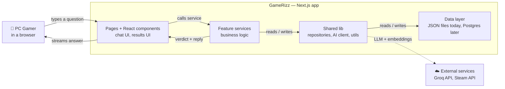
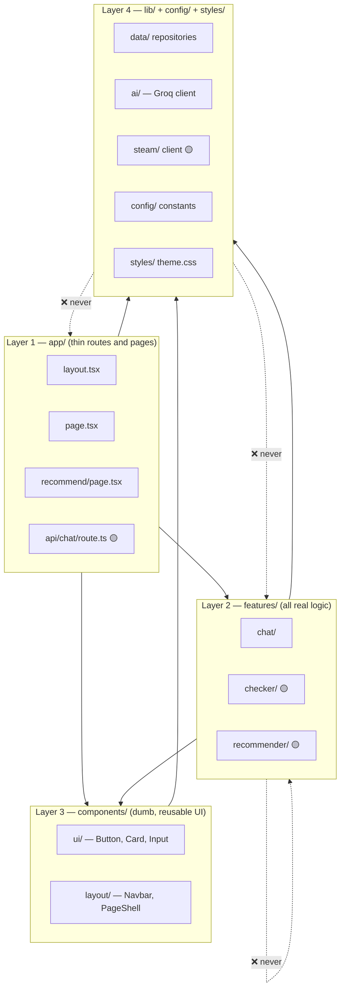
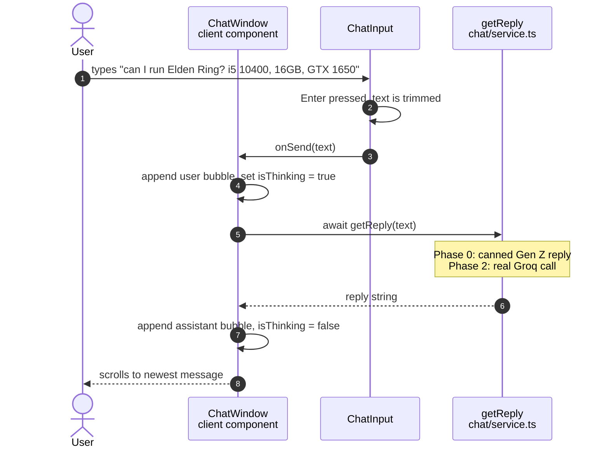
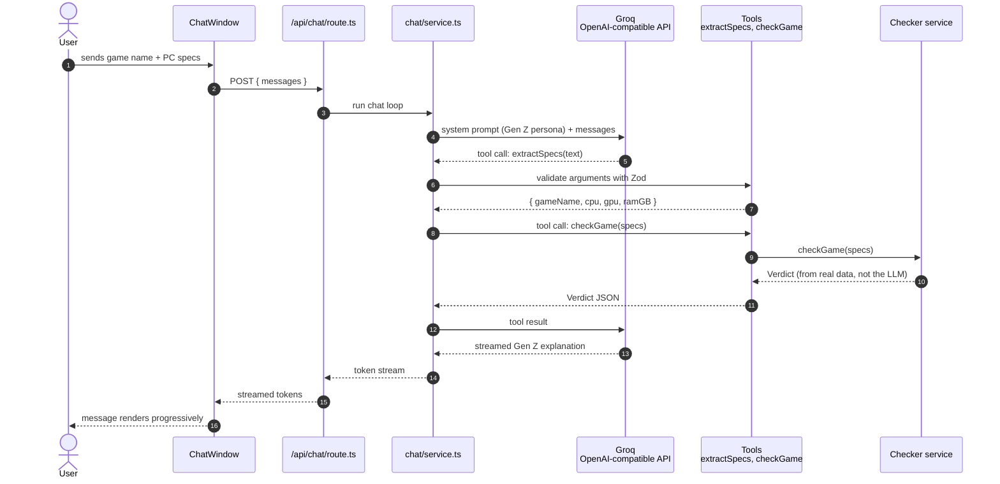
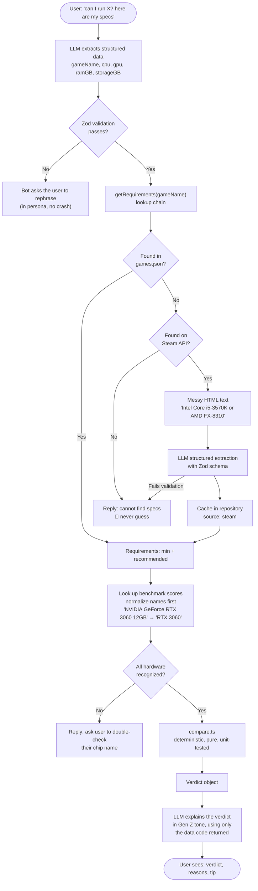
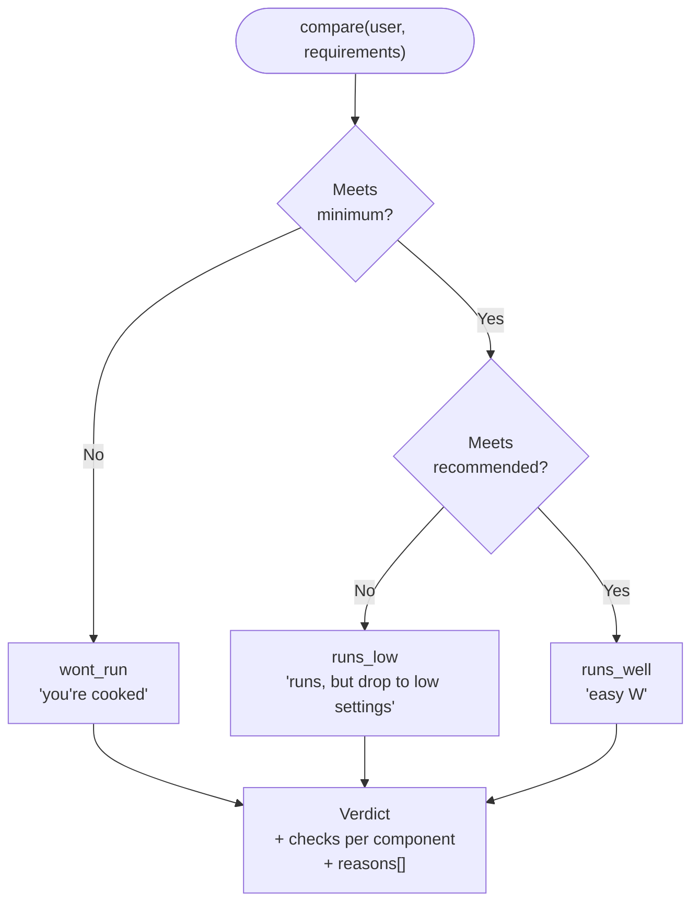
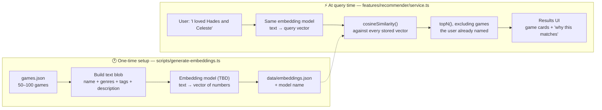
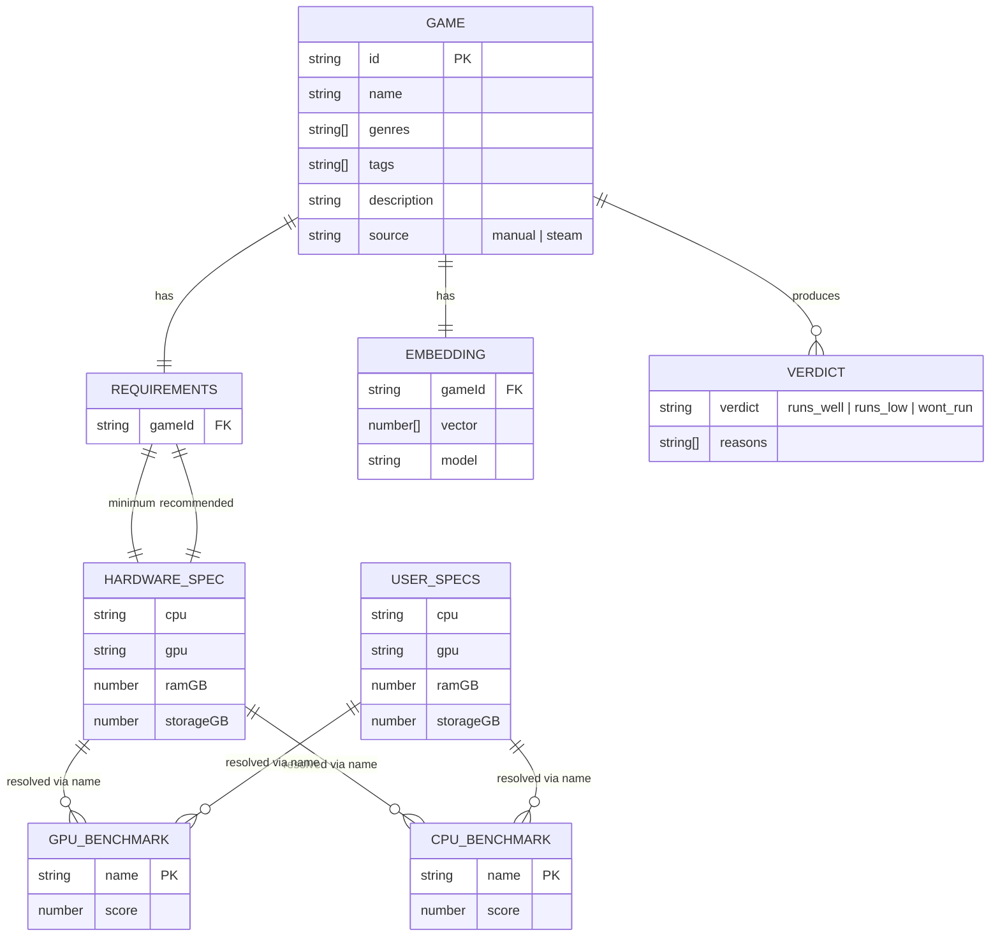
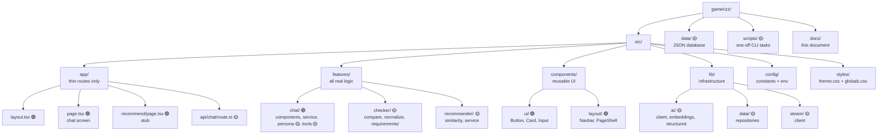
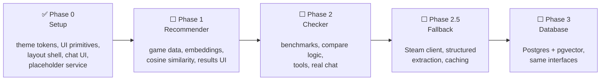

# GameRizz — Workflow & Architecture Diagrams

This document explains **how GameRizz works** using diagrams first, then short plain-language notes. You do not need to read the code to understand it.

Read it in this order:

1. [The 30-second overview](#1-the-30-second-overview) — what the app does at a glance
2. [Layered architecture](#2-layered-architecture) — the one rule that keeps the code clean
3. [Runtime flows](#3-runtime-flows) — step-by-step journeys through the app
4. [Data model](#4-data-model) — what data exists and how it connects
5. [Roadmap](#5-roadmap--what-exists-vs-what-is-planned) — what is built today vs planned

---

## How to read the diagrams

| Element | Meaning |
|---|---|
| Rectangle | A piece of code (page, component, service, repository) |
| Diamond | A decision (a branch in logic) |
| Rounded shape | A start / end point or an external system |
| Solid arrow | "Calls" or "imports" |
| Dotted arrow | Planned / not built yet |
| 🟢 green note | Exists in the codebase **today** |
| 🟡 amber note | Planned for a later phase |

> **Status:** this document describes the current **Phase 0** state plus the target design. Every diagram labels which parts are built and which are not.

---

## 1. The 30-second overview

GameRizz is a web app for PC gamers with exactly two features:

1. **Chatbot** — "Can my PC run this game?" (Feature 2)
2. **Recommender** — "I liked these games, what should I play next?" (Feature 1)

The chatbot is the entry point users see today.

**The mental model:** the user talks to the UI. The UI never does the thinking. A *feature service* does the thinking, using *shared libraries* for data access and AI calls. Verdicts come from **code + real data**, never from the LLM's memory.

---

## 2. Layered architecture

This is the most important rule in the project. Code may only import **downward**:

**The four rules this diagram encodes:**

| Rule | Why it matters |
|---|---|
| Routes are **thin** | `app/` only parses input, calls a service, returns the result |
| Features **own their logic** | Adding a feature = adding a folder, not editing ten files |
| Features **never import each other** | Sharing happens through `lib/` or a repository, never directly |
| `lib/` **never imports upward** | Infrastructure stays generic and reusable |

**Why bother?** Because it makes swapping pieces cheap. When JSON storage becomes PostgreSQL, only `lib/data/` changes. When Groq is replaced by another provider, only `.env` (key, base URL, model) changes. No feature or UI code is touched.

---

## 3. Runtime flows

### 3a. Chat flow — 🟢 what is running right now (Phase 0)

The UI, layout, theme, and message loop all work today. The "brain" is a placeholder so the screen is testable before any API key exists.

Everything here is **client-side**. No network call, no API key, no cost. That is deliberate: the chat shell was proven working before adding an LLM.

---

### 3b. Chat flow — 🟡 the Phase 2 target (real AI + tools)

Once the checker exists, the service moves behind an API route so the API key stays on the server.

**The key idea:** the LLM is used **twice** for language (understand the request, explain the answer) and **never** for the verdict. The verdict is computed by plain TypeScript.

---

### 3c. Requirement checker — 🟡 the core logic (Phase 2)

This is the app's most important flow. It follows the principle **"LLM for language, code for facts."**

**Why the verdict is code, not AI:** LLMs hallucinate hardware numbers. A deterministic comparison is testable, reproducible, and honest. The LLM only turns the result into friendly words.

---

### 3d. Verdict decision table — 🟡 (what `compare.ts` produces)

Each component (CPU, GPU, RAM, storage) is checked separately, so the bot can say *"GPU's fine, RAM is the bottleneck"* instead of a vague yes/no.

---

### 3e. Recommender — 🟡 Phase 1

Two separate steps: a **one-time** embedding generation, then fast lookups at query time.

**The two concepts, in one line each:**

- **Embedding** — a model turns text into a list of numbers (a vector). Texts with similar *meaning* produce vectors that point in similar directions.
- **Cosine similarity** — a number from $-1$ to $1$ measuring the angle between two vectors. Close to $1$ means semantically similar. We compute it in plain JS first:

$$
\cos(\mathbf{a},\mathbf{b}) = \frac{\mathbf{a} \cdot \mathbf{b}}{\lVert \mathbf{a} \rVert \, \lVert \mathbf{b} \rVert}
= \frac{\sum_{i=1}^{n} a_i b_i}{\sqrt{\sum_{i=1}^{n} a_i^2} \; \sqrt{\sum_{i=1}^{n} b_i^2}}
$$

**Rule:** the embedding model used for games and for queries must be identical, which is why the model name is stored next to the vectors.

---

## 4. Data model

**Where each piece lives:**

| Data | File today | Later |
|---|---|---|
| Games + requirements | `data/games.json` | PostgreSQL |
| Embedding vectors | `data/embeddings.json` | PostgreSQL + pgvector |
| GPU scores | `data/gpu-benchmarks.json` | PostgreSQL |
| CPU scores | `data/cpu-benchmarks.json` | PostgreSQL |

Nobody reads these files directly except the repository implementations in `lib/data/json/`. That is what makes the database migration a one-file change.

---

## 5. Folder map — which box does what

🟢 = exists today · 🟡 = planned

---

## 6. Roadmap — what exists vs what is planned

| Phase | Deliverable | Status |
|---|---|---|
| 0 | Themed, structured app with working chat shell | ✅ done |
| 1 | Game recommender with real embeddings | not started |
| 2 | Deterministic "can I run it?" checker + real chat | not started |
| 2.5 | Steam fallback for games outside our dataset | not started |
| 3 | PostgreSQL + pgvector behind existing interfaces | not started |

---

## 7. Glossary — plain-language AI terms used here

| Term | Plain meaning |
|---|---|
| **LLM** | Large Language Model — the text-in, text-out AI (here: Groq, `qwen/qwen3.8-27b`) |
| **Embedding** | Text converted into a list of numbers, so "similar meaning" becomes "similar numbers" |
| **Vector** | That list of numbers |
| **Cosine similarity** | A $[-1, 1]$ score for how closely two vectors point in the same direction |
| **System prompt** | Standing instructions that shape the AI's personality (the Gen Z persona lives in one file) |
| **Tool calling** | Letting the model ask our code to run a function, e.g. "extract these specs" or "check this game" |
| **Structured extraction** | Forcing the model to return typed JSON that matches a schema, instead of free text |
| **Streaming** | Sending the reply word-by-word so it renders as it is written |
| **Zod** | A TypeScript library that validates data shape at runtime — used for env vars, API input, and AI output |
| **Repository** | An interface that hides where data lives, so JSON can become Postgres without touching features |
| **Hallucination** | The model confidently stating something false — the reason verdicts are computed by code, never by AI |

---

## 8. The one-sentence summary of the whole architecture

> **The UI talks, the AI translates, the code decides, and the repository hides where the data lives.**

Every diagram above is a zoom-in on some part of that sentence.